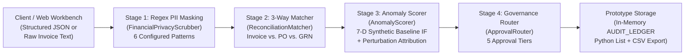

# FinDoc-AuditEngine v3.0 — Prototype Architecture & Technical Specification

**Project Classification:** Internship Capstone Working Prototype / Production-Oriented Reference Implementation  
**Currency Display:** USD (`$`) and INR (`1 USD = 86.50 INR` configured conversion rate)  
**Verified Automated Tests:** Day 29: `28 passed` (`python -m pytest tests -q`) | Day 30: `33 passed` (`python -m pytest tests -q`) — *all collected tests passed*

---

## 1. Architectural Overview & Prototype Scope

`FinDoc-AuditEngine v3.0` is a modular FastAPI prototype designed to demonstrate how deterministic procurement accounting rules can be combined with pre-inference regex privacy masking and unsupervised anomaly scoring.

---

## 2. Detailed Stage Breakdown

### Stage 1: Regex-Based Pre-Inference Privacy Masking (`app/core/privacy.py`)
- **`FinancialPrivacyScrubber.scrub_text()`:** Scans input strings against **6 configured regular expression patterns** before logging or downstream processing:
  1. `EMAIL` (`[A-Za-z0-9._%+-]+@[A-Za-z0-9.-]+\.[A-Za-z]{2,7}`)
  2. `PAN` (Indian Permanent Account Number format: `[A-Z]{5}[0-9]{4}[A-Z]{1}`)
  3. `CREDIT_CARD` (16-digit card sequences)
  4. `ACCOUNT` (8–18 digit numbers preceded by `account`, `acct`, `iban`, `acc`, or `bank`)
  5. `PHONE` (10-digit Indian mobile numbers starting with `6–9`, optional `+91`)
  6. `AADHAAR` (12-digit format `[1-9]\d{3}\s?\d{4}\s?\d{4}`)
- **Invoice-Text Parser (`POST /api/v1/audit/parse-raw`):** Applies regex extraction on raw text memos to populate Invoice ID, PO Number, Vendor Name, Country code, and USD total while masking matched PII tokens into indexed surrogates (`[EMAIL_01]`, `[PAN_02]`). *Note: This endpoint performs regex-based invoice-text parsing on character strings; it does not integrate an optical character recognition (OCR) engine for scanned images/PDFs.*

### Stage 2: Deterministic 3-Way Reconciliation (`app/services/matcher.py`)
- **`ReconciliationMatcher.match()`:** Enforces the configured SKU-level pricing, dock quantity, and subtotal rules between an `InvoicePayload` and a `PurchaseOrderRecord`:
  - **Unit Rate Check:** Flags `RATE_VARIANCE` if `invoice_item.unit_price - po_item.unit_price > $0.01`.
  - **Dock GRN Net Quantity Check:** Computes net accepted units $Q_{\text{net}} = Q_{\text{received}} - Q_{\text{rejected}}$ and flags `QTY_SHORTAGE` if billed quantity exceeds $Q_{\text{net}}$.
  - **Subtotal Tolerance:** Enforces `SUBTOTAL_TOLERANCE = 0.05` (`$0.05`) to prevent binary floating-point rounding discrepancies on tax calculations from causing false rejections.

### Stage 3: 7-Feature Unsupervised Anomaly Scoring & Perturbation Attribution (`app/services/anomaly_detector.py`)
> **Important Model Scope Statement:**  
> *The Isolation Forest model (`n_estimators=200`, `StandardScaler`, `random_state=42`) is trained on a reproducible seeded synthetic baseline of 1,000 transaction-like records to demonstrate financial anomaly scoring. Its thresholds and risk behavior would require evaluation and calibration against representative, authorized real-world data before production use. Furthermore, the displayed `0–100` risk score is an engineered anomaly-risk indicator derived from tree isolation depth, not a calibrated probability of fraud.*

| Index | Feature Key | Mathematical Definition | Synthetic Baseline Role |
| :--- | :--- | :--- | :--- |
| `0` | `log_total_usd` | $\ln(1 + \text{Total}_{\text{USD}})$ | Compresses heavy-tailed invoice dollar totals so magnitude does not dominate bounded ratios. |
| `1` | `price_variance_ratio` | $\Delta P_{\text{USD}} / \max(\text{Subtotal}_{\text{PO}}, 1)$ | Captures relative unit-price markup above PO contract rates. |
| `2` | `qty_shortage_ratio` | $Q_{\text{short}} / \max(Q_{\text{billed}}, 1)$ | Captures fraction of billed units missing or rejected at the receiving dock. |
| `3` | `tax_rate_deviation` | $|\tau_{\text{inv}} - 0.18|$ | Captures deviation from the standard `18%` GST benchmark. |
| `4` | `line_item_concentration` | $\max_i(\text{LineTotal}_i) / \text{Subtotal}_{\text{inv}}$ | Distinguishes single-SKU lump-sum charges from multi-line orders. |
| `5` | `jurisdiction_risk_weight` | `0.05` (Domestic/Standard) to `1.00` (`BZ`, `KY`, `VG`, `PA`) | Encodes configured vendor country risk tier. |
| `6` | `payment_urgency_index` | $\min(1.0, 15.0 / \max(\text{payment\_days}, 1))$ | Flags rush wire demands (`Net-1` to `Net-3`) vs. standard `Net-30`. |

- **Local Perturbation Attribution:** For each feature $k \in \{0,\dots,6\}$, the scorer replaces $x_k$ with its synthetic baseline median $\mu_k$ and computes the marginal score difference $\Delta R_k = \max(0, R(\mathbf{x}) - R(\mathbf{x}^{(k \leftarrow \mu_k)}))$ to surface the top contributing features in the UI.

### Stage 4: Governance Routing & In-Memory Prototype Ledger (`app/services/router.py` & `app/routers/audit.py`)
- **`ApprovalRouter.route_decision()`:** Assigns one of 5 governance tiers (`TIER_1_STP_AUTO_APPROVED`, `TIER_2_MANAGER_REVIEW`, `TIER_3_DIRECTOR_SIGNOFF`, `REJECTED_DISCREPANCY`, or `FROZEN_FRAUD_RISK`).
- **In-Memory Prototype Audit Ledger (`AUDIT_LEDGER`):** Decisions are stored in an in-memory Python list during runtime for dashboard filtering and CSV export (`GET /api/v1/audit/export/csv`).

---

## 3. Current Prototype Limitations & Planned Future Work

| Area | Current Prototype Implementation | Planned Production Improvement (Future Work) |
| :--- | :--- | :--- |
| **Audit Ledger Storage** | Held in an in-memory Python list (`AUDIT_LEDGER`); records are lost when the server process restarts. | Migrate to durable **PostgreSQL (`SQLAlchemy 2.0` + `asyncpg`)** tables with **Redis** idempotency keys. |
| **ML Training Data & Calibration** | Fit on a seeded synthetic baseline of 1,000 records; outputs an uncalibrated `0–100` anomaly indicator. | Train and validate on authorized historical enterprise AP data; calibrate probabilities and monitor drift (**EvidentlyAI PSI**). |
| **Document Ingestion** | Accepts structured JSON or performs regex invoice-text parsing (`/api/v1/audit/parse-raw`). | Integrate optical OCR and layout-aware document extraction (**LayoutLMv3** / PDF table parsing). |
| **PII Masking Coverage** | Uses 6 deterministic regex patterns; may miss non-standard formats or free-form names/addresses. | Combine regex rules with context-aware Named Entity Recognition (**Presidio / Transformer NER**). |
| **Security & Access Control** | Local prototype endpoints without user authentication or role-based authorization. | Add **OAuth2 / JWT** authentication, role-based access control (RBAC), and TLS termination. |
