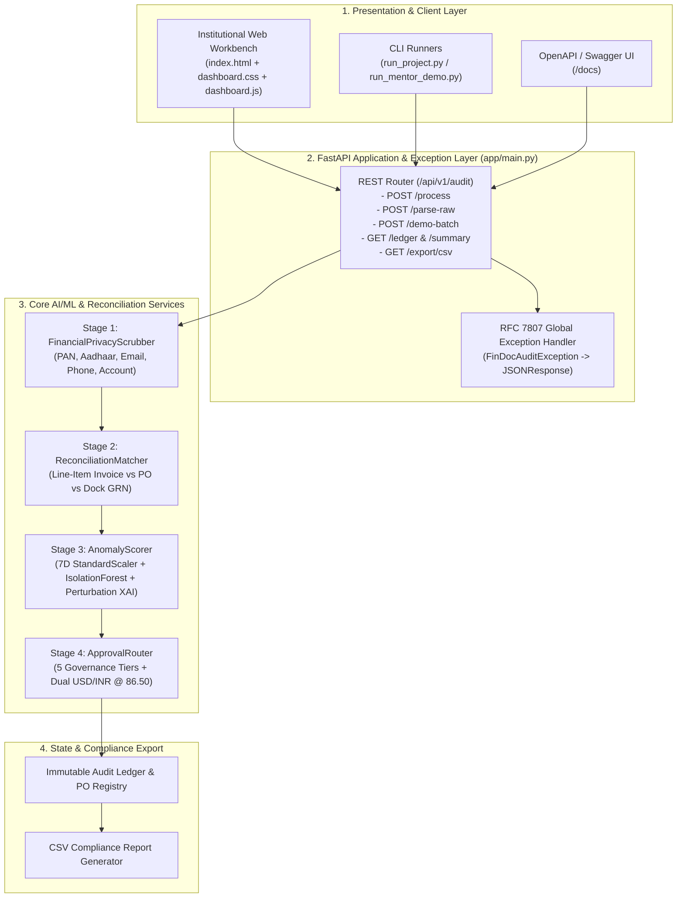

# Day 29 Deliverable: FinDoc-AuditEngine v3.0 System Architecture Specification

## 1. High-Level Component Topology

---

## 2. 7-Dimensional ML Feature Vector Specification

| Index | Feature Name | Mathematical Formulation | Normal Operational Range | Anomaly Trigger Condition |
| :--- | :--- | :--- | :--- | :--- |
| `0` | **Log Capital Scale** | $\ln(1 + \text{Total}_{\text{USD}})$ | $4.8 - 10.3$ (`$120 - $30k`) | Extreme capital outliers (`> $40,000`) |
| `1` | **Unit Rate Markup %** | $\frac{|\Delta P_{\text{USD}}|}{\text{Base Spend}} \times 100$ | $0.0\% - 0.5\%$ | Vendor unit price exceeds PO rate (`> 1%`) |
| `2` | **Dock GRN Shortage %** | $\frac{\Delta Q_{\text{units}}}{Q_{\text{billed}}} \times 100$ | $0.0\%$ | Billed units rejected or missing at dock |
| `3` | **Tax Deviation** | $\max(0, \text{Tax}\% - 20.0\%)$ | $0.0\%$ | Tax rate exceeds corporate indirect tax ceiling |
| `4` | **Payment Urgency** | $\min(10, \frac{30}{\max(1, \text{DueDays})})$ | $1.0 - 2.0$ (`Net-30` to `Net-15`) | Rush wire demand (`<= 5 days`, urgency `>= 6.0`) |
| `5` | **Vendor Risk Profile** | $0.55 \cdot \mathbb{I}_{\text{new}} + 0.45 \cdot \mathbb{I}_{>\$5k} + 0.75 \cdot \mathbb{I}_{\neg\text{PO}}$ | $0.0 - 0.35$ | New vendor high-value spend or missing PO |
| `6` | **Jurisdiction AML Index** | Lookup in `JURISDICTION_RISK_MAP` | $0.05 - 0.08$ (`IN`, `US`, `DE`, `GB`) | Offshore tax havens (`BZ`, `KY`, `PA`, `VG` $\ge 0.88$) |

---

## 3. Corporate Governance Routing Matrix (`1 USD = 86.50 INR`)

| Approval Tier | USD Threshold | INR Threshold (`@ 86.50`) | 3-Way Match Required | Max Risk Level | HITL Required |
| :--- | :--- | :--- | :--- | :--- | :--- |
| `TIER_1_STP_AUTO_APPROVED` | `< $1,000.00` | `< INR 86,500.00` | `True` (`matched`) | `LOW` (`< 35.0`) | `False` (Autonomous) |
| `TIER_2_MANAGER_REVIEW` | `$1,000 – $10,000` | `INR 86,500 – 865,000` | `True` (`matched`) | `LOW` / `MEDIUM` | `True` (Manager) |
| `TIER_3_DIRECTOR_SIGNOFF` | `> $10,000.00` | `> INR 865,000.00` | `True` (`matched`) | `LOW` / `MEDIUM` / `HIGH` | `True` (Director) |
| `REJECTED_DISCREPANCY` | Any Amount | Any Amount | `False` (`unmatched`) | Any | `True` (Vendor Hold) |
| `FROZEN_FRAUD_RISK` | Any Amount | Any Amount | Any | `CRITICAL` (`>= 85.0`) | `True` (Security Freeze) |
