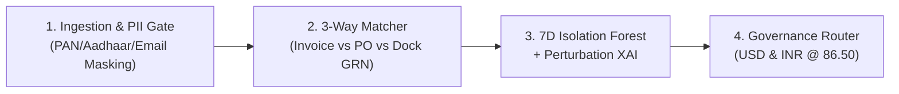

# Day 29 Deliverable: Presentation Slide Deck & Speaker Notes (10–15 Min Mentor Defense)

**Title:** FinDoc-AuditEngine v3.0 — Enterprise 3-Way Financial Reconciliation & Explainable ML Audit Gateway  
**Presenter:** Shri Sanjaykumar V (AI/ML Intern, Linkific Technology Solutions Pvt Ltd)  
**Total Duration:** 12–15 Minutes (10 Mins Presentation + Live Demo, 3–5 Mins Mentor Q&A)

---

## Time Allocation & Pacing Roadmap

| Time Window | Section / Activity | Slides Covered |
| :--- | :--- | :--- |
| **00:00 – 01:30** | Problem Statement, Business Impact & Dual-Currency Context | Slides 1 – 2 |
| **01:30 – 04:00** | 4-Stage System Architecture, PII Guardrail & 3-Way Matching Math | Slides 3 – 5 |
| **04:00 – 06:30** | 7-Feature Isolation Forest ML Engine & Perturbation XAI | Slides 6 – 8 |
| **06:30 – 10:30** | **LIVE MENTOR DEMO** (Dynamic Custom Inputs, Raw Text PII, 5-Case Batch) | Slide 9 + Live Browser/CLI |
| **10:30 – 12:00** | Testing Rigor (25/25 PyTest), Engineering Challenges & Future Roadmap | Slides 10 – 12 |
| **12:00 – 15:00** | Technical Defense & Mentor Q&A | Open Q&A |

---

## Slide-by-Slide Content & Verbatim Speaker Notes

### Slide 1: Title & Executive Value Proposition
- **Visuals:** Project title, Linkific branding, architecture badge (`FastAPI + Scikit-Learn IsolationForest + Institutional Workbench`), fixed FX peg (`1 USD = 86.50 INR`).
- **Speaker Notes:**
  > "Good morning/afternoon mentors. Today I am presenting **FinDoc-AuditEngine v3.0**, an enterprise-grade financial document processing and multi-tier audit gateway built at Linkific. Our goal was to solve a critical problem in modern Accounts Payable: how to automate high-volume invoice approvals without exposing the company to unit-rate overcharges, dock delivery shortages, PII leaks, or offshore wire fraud."

### Slide 2: The Business Problem in Enterprise Accounts Payable
- **Bullet Points:**
  - Manual AP review costs `$12–$18` per invoice and introduces 5–10 day settlement delays.
  - Naive rule-based automation misses subtle multivariate anomalies (e.g., new vendor + rushed Net-1 due date + offshore jurisdiction).
  - LLM-only approaches hallucinate arithmetic and leak sensitive tax IDs (PAN / Aadhaar).
- **Speaker Notes:**
  > "When enterprises process thousands of vendor invoices, pure manual review is too slow, while naive automation is dangerous. Furthermore, sending raw financial documents directly to external LLMs risks arithmetic hallucination and PII exposure. FinDoc-AuditEngine solves this by combining deterministic 3-way mathematical reconciliation with an unsupervised Isolation Forest ML model and pre-inference PII redaction."

### Slide 3: End-to-End 4-Stage Architecture

- **Speaker Notes:**
  > "Every invoice—whether entered dynamically in our workbench, parsed from raw unstructured text, or submitted via REST API—passes through four stages in under 2 milliseconds: Stage 1 scrubs PII tokens; Stage 2 runs deterministic line-item 3-way matching; Stage 3 executes our 7-feature Isolation Forest scorer with perturbation explainability; and Stage 4 routes the transaction into the appropriate corporate governance tier in both USD and INR."

### Slide 4: Stage 1 — Responsible AI & Pre-Inference Privacy Scrubber
- **Key Highlights:**
  - Pre-compiled regex detection for **Indian PAN**, **Aadhaar**, **Email**, **Phone**, **Credit Card**, and **Bank Account**.
  - Replaces raw tokens with deterministic surrogates (`[PAN_01]`, `[EMAIL_01]`).
- **Speaker Notes:**
  > "Before any data touches our ML layer or audit logs, `FinancialPrivacyScrubber` sanitizes sensitive identifiers. We also exposed this via `/api/v1/audit/parse-raw`, allowing auditors to paste unstructured invoice text and watch PII redaction happen live."

### Slide 5: Stage 2 — Deterministic 3-Way Reconciliation Engine
- **Key Highlights:**
  - Line-item verification across **Invoice**, **ERP Purchase Order (PO)**, and **Dock Goods Receipt Note (GRN)**.
  - Exact calculation of `unit_price_delta_usd` and `accepted_qty = grn_received - grn_rejected`.
  - Produces structured `ItemReconciliationDiff` records for every SKU.
- **Speaker Notes:**
  > "We never rely on probabilistic models for basic arithmetic. Our `ReconciliationMatcher` checks every line item SKU against the committed PO rate and the physical dock GRN acceptance count. If 10 monitors are billed but 2 were rejected as damaged at the loading dock, the engine flags the exact 2-unit shortage and calculates the dollar and rupee variance."

### Slide 6: Stage 3 — Dynamic 7-Feature Isolation Forest ML Engine
- **7 Continuous Features Extracted:**
  1. `log_amount`: $\ln(1 + \text{USD})$
  2. `price_markup_pct`: % overcharge over PO commitment
  3. `qty_shortage_pct`: % of billed units rejected/missing at dock
  4. `tax_rate_deviation`: excess over standard corporate tax band
  5. `payment_terms_urgency`: $30 / \text{due\_days}$ (catches Net-1 rush wire fraud)
  6. `vendor_risk_weight`: counterparty tenure & uncommitted PO status
  7. `jurisdiction_risk_index`: continuous sovereign AML index (`IN`/`US` = 0.05, `AE` = 0.30, `BZ`/`KY`/`PA` = 0.90–0.95)
- **Speaker Notes:**
  > "To make the project 100% dynamic for any real-world input, we engineered 7 continuous behavioral features scaled via `StandardScaler` and scored by a 200-tree `IsolationForest` trained on 1,000 historical AP transactions. Because the model evaluates ratios and continuous indices rather than hardcoded rules, it generalizes to any vendor, amount, or line-item structure."

### Slide 7: Perturbation-Based Explainable AI (XAI)
- **Key Highlights:**
  - Replaces each feature $x_i$ with its compliant baseline median $\bar{x}_i$ and measures $\Delta S_i = S(x^{(-i)}) - S(x)$.
  - Renders horizontal point-contribution bars in the UI so human reviewers see the exact drivers behind every risk score.
- **Speaker Notes:**
  > "In financial auditing, a black-box score isn't enough. We implemented single-feature perturbation attribution: for every invoice, we measure how much each of the 7 features shifts the Isolation Forest decision function away from the compliant median, displaying the top 5 risk drivers in real time."

### Slide 8: Stage 4 — Multi-Tier Governance & Dual Currency Standard
- **Policy Matrix (`1 USD = 86.50 INR`):**
  - **Tier 1 STP Auto-Approved:** `< $1,000` (`< INR 86,500`), Matched, Low Risk (`< 35.0`)
  - **Tier 2 Finance Manager Review:** `$1,000 – $10,000` (`INR 86,500 – 865,000`), Matched, Low/Medium Risk
  - **Tier 3 Executive Director Signoff:** `> $10,000` (`> INR 865,000`), Matched
  - **Rejected (Discrepancy):** Unmatched PO/GRN or Price/Qty Variance
  - **Frozen (Fraud Risk):** Critical ML Risk (`>= 85.0`) or Offshore AML Hold

### Slide 9: Live Demonstration (Workbench + CLI)
- **Demo Flow (4 Minutes):**
  1. Show Institutional Light Workbench at `http://127.0.0.1:8000/dashboard`.
  2. Click **"Run 5-Scenario Batch"** to populate the ledger across all 5 governance tiers.
  3. Click **"New Blank"** or edit line items live (change `Inv Rate` from `$350` to `$450` or `GRN Rej` from `0` to `1`) and show real-time variance pre-calculation and dynamic ML attribution.
  4. Open **"Paste Raw Text / PII"**, scrub an unstructured invoice containing a PAN and email, and export the CSV compliance report.

### Slide 10: Institutional UI/UX & Defensive Error Handling
- **Key Highlights:**
  - High-contrast Swiss accounting grid (`Plus Jakarta Sans` + `IBM Plex Mono` tabular numerals).
  - Custom `FinDocAuditException` hierarchy returning RFC 7807 Problem Details JSON (`404`, `422`, `403`, `500`).

### Slide 11: Quality Assurance — 25/25 Automated PyTest Suite & CI/CD
- **Test Coverage Breakdown:**
  - 10 Core Engine & Dynamic ML Perturbation tests (`test_audit_engine.py`)
  - 2 Domain Exception & RFC 7807 handler tests (`test_error_handling.py`)
  - 8 Frontend Portal, Raw Parser, Demo Batch & CSV Export tests (`test_frontend_routes.py`)
  - 5 End-to-End Benchmark & Dynamic Custom Scenario Regression tests (`test_regression.py`)

### Slide 12: Production Roadmap & Q&A
- **Future Enhancements:**
  - PostgreSQL + `pgvector` semantic duplicate detection.
  - Multimodal VLM/OCR PDF table extraction upstream.
  - Active learning feedback loop from Manager/Director signoff overrides.
