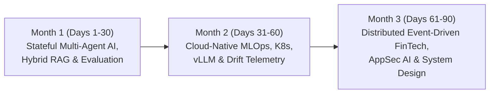

# Personal Learning Roadmap — Next 90 Days (Post-Internship Career Acceleration)

**Engineer:** Shri Sanjaykumar V (`M.Tech Integrated in Software Engineering, VIT Vellore — CGPA: 9.12/10.0`)  
**Baseline Completed (Day 30):** Python, FastAPI, Pydantic v2, PyTest, RAG Pipelines (`TForce India` & `CampusLLM`), DevSecOps (`LEGITIFY`), Classical & Deep Learning (`Solar Forecasting`), and Hybrid Rules + 7-D Explainable ML (`FinDoc-AuditEngine v3.0` at `Linkific`).  
**90-Day Objective:** Transition from strong single-node AI/ML & Backend Microservices to **Distributed Production AI Systems, Cloud-Native MLOps (Kubernetes/Kafka/vLLM), and High-Scale System Design** ready for top-tier SDE / AI Engineer roles (Visa, Stripe, Enterprise Cloud & FinTech).

---

## Roadmap Architecture Overview

---

## Phase 1: Days 1–30 (Month 1) — Stateful Agentic Architectures, Hybrid RAG & Rigorous LLM Evaluation

| Week | Days | Core Technical Theme | Actionable Study & Implementation Tasks | Concrete Deliverable / KPI |
| :--- | :--- | :--- | :--- | :--- |
| **Week 1** | Days 1–7 | **Hybrid Retrieval (`BM25 + Dense Vector + Cross-Encoder Reranking`)** | Implement Reciprocal Rank Fusion (RRF) combining sparse `BM25` keyword matching (for exact SKU/PO codes) with dense vector embeddings (`bge-large-en` / `Qdrant`) and `ms-marco` cross-encoder reranking. | Upgrade `CampusLLM` & `FinDoc-AuditEngine` policy search with RRF; benchmark Recall@5 improvement (`>= +18%`). |
| **Week 2** | Days 8–14 | **Stateful Multi-Agent Workflows (`LangGraph` & Tool Calling)** | Build cyclic, state-persisted agent graphs with deterministic checkpointing, human-in-the-loop (HITL) approval interrupts, and strict JSON Schema tool definitions. | Autonomous Procurement Dispute Resolution Agent that drafts vendor chargeback memos from `FinDoc-AuditEngine` item diffs. |
| **Week 3** | Days 15–21 | **Automated AI Evaluation (`RAGAS`, `DeepEval` & Golden Datasets)** | Build CI-integrated evaluation harnesses measuring **Faithfulness**, **Context Precision**, **Answer Relevance**, and **Hallucination Rate** across 100+ adversarial test prompts. | GitHub Actions quality gate that fails PRs if faithfulness drops below `0.92` or latency exceeds `P95` budget. |
| **Week 4** | Days 22–30 | **Multimodal Document AI (`LayoutLMv3` / Vision-Language OCR)** | Replace regex-only text extraction with layout-aware bounding-box table extraction for scanned multi-page PDF GST/VAT invoices and bills of lading. | End-to-end PDF-to-`InvoicePayload` extraction microservice with token-level confidence calibration. |

---

## Phase 2: Days 31–60 (Month 2) — Cloud-Native MLOps, High-Throughput Inference & Drift Observability

| Week | Days | Core Technical Theme | Actionable Study & Implementation Tasks | Concrete Deliverable / KPI |
| :--- | :--- | :--- | :--- | :--- |
| **Week 5** | Days 31–37 | **Async Persistence (`PostgreSQL + SQLAlchemy 2.0 + asyncpg + Redis`)** | Migrate in-memory ledgers to partitioned PostgreSQL tables with Alembic migrations, optimistic concurrency locking, and Redis idempotency keys (`24h TTL`). | Zero-duplicate transactional audit ledger supporting `1,000+ concurrent req/sec` under `locust` load testing. |
| **Week 6** | Days 38–44 | **Model Registry, Versioning & Drift Monitoring (`MLflow` + `EvidentlyAI`)** | Version `StandardScaler + IsolationForest` artifacts in `MLflow`; compute weekly **Population Stability Index (PSI)** and **Wasserstein Distance** across the 7 financial features. | Automated drift alert webhook triggered whenever $\text{PSI} > 0.20$ on vendor price variance or tax distributions. |
| **Week 7** | Days 45–52 | **High-Throughput Model Serving (`ONNX Runtime` & `vLLM`)** | Export scikit-learn/XGBoost pipelines to `ONNX Runtime` for sub-millisecond C++ execution; benchmark quantized LLM serving (`AWQ`/`GPTQ`) with continuous batching. | Reduce 7-D anomaly + perturbation XAI inference latency from `7.9 ms` to `< 1.8 ms` via vectorized batch perturbation. |
| **Week 8** | Days 53–60 | **Kubernetes (`EKS/AKS`), Docker Multi-Stage Builds & OpenTelemetry** | Package services into distroless multi-stage Docker images (`<150 MB`), write Helm charts with Horizontal Pod Autoscalers (HPA), and instrument `Prometheus + Grafana` dashboards. | Production K8s deployment manifest with `P50/P95/P99` latency histograms and automated liveness/readiness probes. |

---

## Phase 3: Days 61–90 (Month 3) — Event-Driven FinTech Scale, AppSec AI & Career Execution

| Week | Days | Core Technical Theme | Actionable Study & Implementation Tasks | Concrete Deliverable / KPI |
| :--- | :--- | :--- | :--- | :--- |
| **Week 9** | Days 61–67 | **Event-Driven Streaming (`Apache Kafka` / `RabbitMQ` + `Celery`)** | Decouple high-volume ERP invoice ingestion from downstream ML scoring and webhook notifications using durable Kafka topics and dead-letter queues (DLQ). | Event-driven `FinDoc-AuditEngine v4.0` handling burst loads of `10,000 invoices/min` with zero message loss. |
| **Week 10** | Days 68–75 | **AI Security, Adversarial Robustness & OWASP LLM Top 10** | Combine `LEGITIFY` (AppSec) with `FinDoc-AuditEngine`: defend against prompt injection inside invoice descriptions, data poisoning, and model inversion attacks. | Security hardening suite & automated red-team adversarial test harness (`50+ injection payloads blocked`). |
| **Week 11** | Days 76–82 | **Distributed System Design & Algorithmic Mastery** | Solve 60+ medium/hard DSA problems (Graphs, Dynamic Programming, Heaps, Tries) and author 6 end-to-end system design architectures (Payment Switch, Real-Time Fraud Engine, Distributed Rate Limiter). | Complete System Design & Coding Interview Portfolio repository with benchmarked implementations. |
| **Week 12** | Days 83–90 | **Open-Source Contribution, Technical Writing & Panel Readiness** | Publish 2 deep-dive engineering articles (*"Perturbation XAI for Unsupervised Financial Anomaly Detection"* and *"Pre-Inference PII Gateways in FastAPI"*) and contribute a PR to an open-source Python/AI library. | Published engineering blog posts, merged OSS pull request, and full interview readiness for tier-1 SDE/AI roles. |

---

## 90-Day Success Metrics Summary

1. **System Performance:** Reduce `FinDoc-AuditEngine` P99 inference latency to **`< 3 ms`** via vectorized ONNX batching and scale throughput to **`1,000+ RPS`** backed by PostgreSQL + Redis.
2. **Engineering Rigor:** Maintain **`>= 95%` test coverage** across all portfolio repositories with automated CI/CD quality and security gates.
3. **Career Readiness:** Complete **60+ targeted DSA problems**, **6 FinTech/AI system design blueprints**, and **2 published technical articles** showcased on LinkedIn and GitHub.
